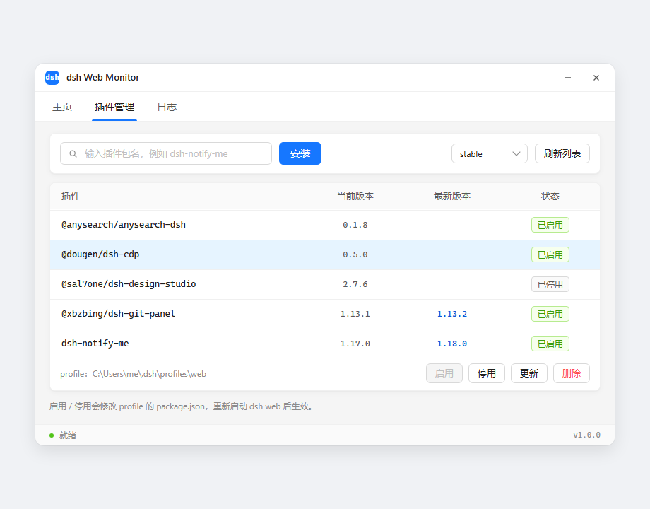
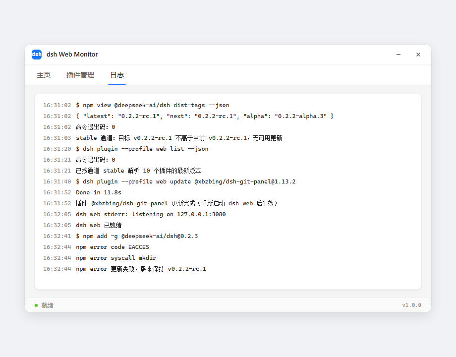

<p align="center">
  
</p>

<h1 align="center">dsh Web Monitor</h1>

<p align="center">
  一个窗口照看本机的 dsh web：启停服务、检查更新、管理插件、查看日志。
</p>

dsh Web Monitor 是 Windows 桌面工具，用于监控本机 `dsh web` 服务（默认监听 `127.0.0.1:3080`）。它把服务控制、dsh 全局包与插件更新、运行日志集中在一个界面里。

## 功能

- **服务状态**：显示 dsh web 运行状态、监听地址、进程 PID 与来源（本程序启动 / 外部启动 / 端口被占用），提供启动、停止、重新启动、打开 Web UI。
- **安全的身份判定**：只有 `node.exe` 且命令行命中 dsh 包入口（`…/dsh/lib/bin.js`）并带 `web` 子命令的进程才被认定为 dsh web；停止前复核 PID 与启动时间，不误杀无关进程。启动只检查端口占用，不结束其它进程。
- **dsh 更新**：检测全局安装的 `@deepseek-ai/dsh`，支持 stable / rc / beta / alpha / next 通道，目标版本高于已安装版本时才允许更新。
- **插件管理**：查看插件版本、最新版本与启用状态；支持安装、启用、停用、更新、删除和按通道一键更新，版本只升不降。
- **日志**：dsh web 与插件 / npm 命令输出汇总到同一页，按来源着色，停在底部时自动跟随，内存保留最近 2000 行。
- **托盘**：关闭窗口收进托盘，Explorer 重启后自动重新登记；托盘注册失败时降级为最小化到任务栏，关闭即退出。

## 界面


*主页：服务状态、插件概况与 dsh 全局包*



*插件管理：插件列表、更新通道与单项操作*



*日志：dsh web 与插件 / npm 命令输出*

## 系统要求

| 项目 | 要求 |
| --- | --- |
| 操作系统 | Windows 10 1607 及以上 / Windows 11 / Windows Server 2016 及以上（64 位） |
| 运行时 | [.NET 10 Desktop Runtime（x64）](https://dotnet.microsoft.com/download/dotnet/10.0) |
| Node.js | 24.9.0 或更高，`node`、`npm`、`dsh` 均在 `PATH` 中 |
| dsh | 全局安装 `@deepseek-ai/dsh` |
| 权限 | 程序以 `requireAdministrator` 启动，运行时需要 UAC 提权确认 |

> [!IMPORTANT]
> `DshWebMonitor.exe` 是单文件程序，不包含 .NET 运行时。首次使用前必须安装 .NET 10 Desktop Runtime（x64）。

> [!NOTE]
> Windows 7、Windows 8.1 不受支持：dsh 依赖的 Node.js 24 已不再支持这些系统。

## 安装

1. 安装 [.NET 10 Desktop Runtime（x64）](https://dotnet.microsoft.com/download/dotnet/10.0) 与 [Node.js](https://nodejs.org/) 24.9 或更高版本。
2. 全局安装 dsh：

   ```powershell
   npm add -g @deepseek-ai/dsh
   ```

3. 确认命令行可用：

   ```powershell
   node -v
   npm -v
   dsh --version
   ```

4. 运行 `DshWebMonitor.exe`，在 UAC 提示中选择「是」。

## 使用

### 主页

- **服务状态**：显示运行状态、地址、PID 与进程来源；四个按钮为启动、停止、重新启动、打开 Web UI。
- **插件概况**：显示已安装 / 已启用 / 可更新数量，按当前通道一键更新所有可更新插件。
- **dsh 全局包**：显示安装状态与版本，选择通道后检查更新；发现更高版本时出现「更新」按钮。

> [!TIP]
> 启动时读取一次插件列表并按当前通道检查最新版本，切到插件页直接复用结果；需要重新检查时用插件页「刷新列表」或切换通道。

### 插件管理

- 顶部输入包名（支持 `包名` 或 `包名@版本`）安装，也可切换通道、刷新列表。
- 选中一行后执行启用 / 停用 / 更新 / 删除。
- 启用或停用会改写 profile 的 `dsh.profile.bundles`，**重启 dsh web 后生效**。
- 底部状态栏显示插件总数、已启用数量与当前更新通道。

### 日志

命令输出为蓝色、系统提示为绿色、错误为红色；停在底部时自动跟随，上翻阅读不被打断。右键菜单可复制全部或清空。日志只保存在内存中，程序未处理异常另写入 `%LOCALAPPDATA%\DshWebMonitor\crash.log`。

### 托盘与退出

- 最小化：窗口到任务栏。
- 关闭：窗口收进托盘，程序继续运行；双击托盘图标恢复。
- 退出：右键托盘图标选择「退出」。如果 dsh web 由本程序启动，会随监控器一起结束；外部启动的 dsh web 不受影响。

## 副作用与权限

使用前请了解程序的写操作：

- **管理员权限**：由程序拉起的 dsh web 及插件在同一提权上下文运行。只安装可信来源的插件；管理员进程写出的会话 / 缓存文件可能带高完整性标记，非管理员终端之后无法改写。
- **全局 npm 目录**：安装或更新 dsh 时执行 `npm add -g @deepseek-ai/dsh[@版本]`。
- **dsh profile 配置**：启用 / 停用插件改写 `%USERPROFILE%\.dsh\profiles\web\package.json`（`DSH_HOME` 存在时以它为准）中的 `dsh.profile.bundles`；写入采用临时文件 + 原子替换，并保留 `package.json.bak` 备份。
- **进程操作**：停止 / 重启结束通过身份校验的 dsh web 进程树；启动失败时清理本次启动残留进程。
- **联网**：检查更新、读取插件列表、安装 / 更新时访问 npm registry。
- **应用内缓存与临时目录**：受限环境中 npm 缓存回退到 `%LOCALAPPDATA%\DshWebMonitor\npm-cache`，dsh web 子进程的 `TEMP` / `TMP` / `TMPDIR` 指向应用内可写目录，避免权限失败。
- **应用内 npm 缓存**：设置 `npm_config_cache` 让 npm / npx 子命令共用；启动 dsh web 直接调用 `dsh` CLI，不经过 npm / npx。

## 备份与回滚

- **profile 配置**：每次写入前保留同目录 `package.json.bak`，回滚时先退出 dsh web，再用备份覆盖。
- **dsh 版本**：`npm add -g @deepseek-ai/dsh@<旧版本>`。
- **插件版本**：`dsh plugin --profile web add <包名>@<旧版本>`，重启 dsh web 后生效。

## 常见问题

**提示找不到 npm / dsh**

确认 Node.js 已安装，且 `node`、`npm`、`dsh` 都在 `PATH` 中；安装后重新打开程序。

**提示端口 3080 被占用**

端口被非 dsh 进程使用。程序不会停止它，只显示 PID 并禁用停止 / 重启，请自行处理占用程序。

**为什么显示「外部启动」**

dsh web 不是由本程序启动。通过身份校验后仍可停止、重启、打开 Web UI，但退出监控器时不会被结束。

**重复启动程序**

只允许一个实例；再次运行会把已有窗口带到前台。

**关闭窗口后程序还在运行**

窗口已收进托盘。完全退出请右键托盘图标选择「退出」。

**托盘图标不显示**

受限环境中 Windows 可能拒绝注册托盘图标。程序会校验注册结果，失败时不隐藏窗口、关闭即退出（dsh web 运行时仍会确认）。

**启动时弹出 UAC，可以不用管理员吗**

不可以。程序固定以 `requireAdministrator` 启动，拒绝提权则不会启动。这样 dsh web、npm 全局包与插件操作都在同一提权上下文，避免缓存 / 临时目录权限问题。

**启动失败**

等待端口监听最多 60 秒，超时或进程提前退出判定失败，日志回放 dsh 错误输出并清理残留进程。

**停止或重新启动失败**

日志给出失败原因，状态回到可操作状态，可重试或手动结束对应 PID。

**安装或更新失败**

通常是 npm 全局目录没有写权限；日志显示具体错误。超过 5 分钟的写操作会被终止。

## 从源码构建与测试

需要 .NET 10 SDK。

```powershell
# 构建
dotnet build DshWebMonitor.sln -c Release

# 发布单文件程序（输出到 dist\）
dotnet publish src\DshWebMonitor\DshWebMonitor.csproj -p:PublishProfile=SingleFile-win-x64

# 运行冒烟测试（离线用例，默认）
dotnet run --project tests\DshWebMonitor.SmokeTests

# 连真实环境一起跑（需已装 npm / dsh 并允许访问 3080）
dotnet run --project tests\DshWebMonitor.SmokeTests -- --env
```

测试是自包含控制台程序，入口为 `dotnet run`，不使用 `dotnet test`。仓库另含 `global.json`（固定 SDK）、`.editorconfig` 和第三方组件许可声明 `THIRD-PARTY-NOTICES.md`。

当前版本：**1.0.1**。
