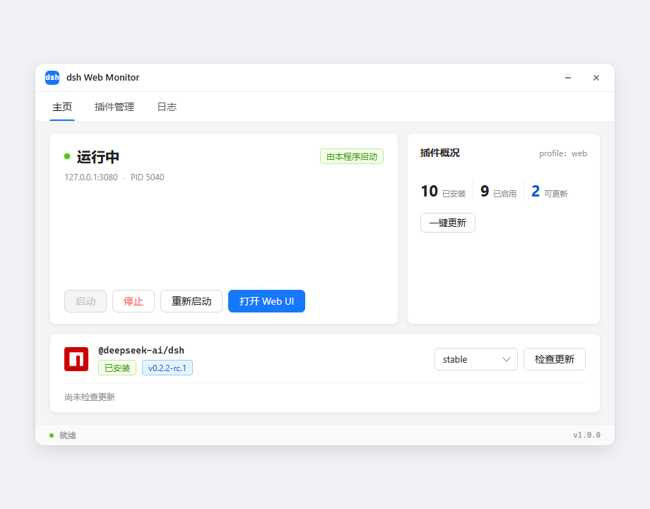

<p align="center">
  
</p>

<h1 align="center">dsh Web Monitor</h1>

<p align="center">
  在一个窗口里照看本机的 dsh web：启动、停止、更新自己，也管理它的插件。
</p>

---

dsh Web Monitor 是一个 Windows 桌面小工具，用来监控本机的 `dsh web` 服务。它会识别命令行命中 dsh 包入口、监听 `127.0.0.1:3080` 的 node 进程，让你启动、停止、重新启动服务，检查 npm 全局包与插件的更新，并在一个窗口里查看运行日志。

## 主要功能

- **服务状态一目了然**：显示 dsh web 是否在运行、监听地址与进程 PID，并标明当前进程是「由本程序启动」「外部启动」还是「外部进程占用」。
- **安全地启停**：只有命令行命中 dsh 包入口（`…/dsh/lib/bin.js`）且带 `web` 子命令的 node 进程才会被认定为 dsh web；由本程序启动的进程及其后代按父子链优先信任。停止 / 重新启动前会用最新的进程信息复核，并在结束前核对 PID 与进程启动时间，不会误杀无关的 node 进程。启动只检查端口占用，不会结束其它进程。
- **dsh 更新**：检测全局安装的 `@deepseek-ai/dsh`，支持 stable / rc / beta / alpha / next / all 更新通道；只有目标版本高于已安装版本时才提供更新。
- **插件管理**：查看插件、当前版本、最新版本与启用状态；支持安装、启用、停用、更新、删除，以及按通道一键更新所有可更新插件（按版本号比较，只升不降）。
- **日志**：把 dsh web 与插件 / npm 命令的输出汇总在同一个日志页，按来源着色，停在底部时自动跟随，可右键复制全部或清空。
- **托盘控制**：关闭窗口收起到托盘；托盘不可用时退化为最小化到任务栏，关闭窗口即退出；退出前会确认，并按 dsh web 的来源给出不同提示。

## 界面



*主页：服务状态、插件概况与 dsh 全局包*


*插件管理：插件列表、更新通道与单项操作*


*日志：dsh web 与插件 / npm 命令输出*

## 系统要求

| 项目 | 要求 |
| --- | --- |
| 操作系统 | Windows 10 1607 及以上 / Windows 11 / Windows Server 2016 及以上（64 位） |
| 运行时 | [.NET 10 Desktop Runtime（x64）](https://dotnet.microsoft.com/download/dotnet/10.0) |
| 权限 | 需要管理员账户：程序以 `requireAdministrator` 启动，每次运行会弹出 UAC 提权确认 |
| Node.js | Node.js **24.9.0 或更高版本**，并确保 `node`、`npm`、`dsh` 在 `PATH` 中 |
| dsh | 全局安装 `@deepseek-ai/dsh`，并确保 `dsh` 命令可用 |

> [!IMPORTANT]
> 分发的 `DshWebMonitor.exe` 是单文件程序，**不包含 .NET 运行时**。第一次使用前必须先安装 **.NET 10 Desktop Runtime（x64）**，否则程序无法启动。

> [!NOTE]
> Windows 7、Windows 8.1 不受支持：dsh 依赖的 Node.js 24 已不再支持这些系统。

## 安装

1. 从发布包中获取 **`DshWebMonitor.exe`**（单文件，无需安装）。
2. 安装 [.NET 10 Desktop Runtime（x64）](https://dotnet.microsoft.com/download/dotnet/10.0)。
3. 安装 [Node.js](https://nodejs.org/) 24.9 或更高版本。
4. 安装 dsh：

   ```powershell
   npm add -g @deepseek-ai/dsh
   ```

5. 确认命令行可用：

   ```powershell
   node -v
   npm -v
   dsh --version
   ```

6. 双击 `DshWebMonitor.exe` 运行；Windows 会弹出 UAC 提权确认，选择「是」后才会启动（程序固定以管理员身份运行）。

## 使用说明

### 主页

主页分为三块：

- **服务状态**：显示当前是否运行、监听地址与 PID，以及进程来源标签。四个按钮分别是启动、停止、重新启动、打开 Web UI。
- **插件概况**：显示已安装 / 已启用 / 可更新的数量。「一键更新」会按当前更新通道依次更新所有可更新插件，并在按钮下方显示结果。
- **dsh 全局包**：显示安装状态与版本，可选择更新通道后点击「检查更新」；发现新版本时才出现「更新」按钮。当前通道没有更高版本、但其它通道有新版本时，提示里会给出该版本与来源通道；检查失败会直接显示失败原因，不会停留在「尚未检查更新」。

> [!TIP]
> 程序启动时会读取一次插件列表并按当前通道检查最新版本；之后切到「插件管理」页直接复用这份结果，不会重复联网检查。需要重新检查时，用插件页的「刷新列表」或切换更新通道。

### 插件管理

- 顶部可以输入包名安装新插件（支持 `包名` 或 `包名@版本`），也可以切换更新通道、刷新列表。
- 点击表格中的一行后，可在底部执行 **启用 / 停用 / 更新 / 删除**。
- 启用或停用会修改 dsh 的 profile 配置，**重新启动 dsh web 后生效**。
- 「更新」只在当前通道的目标版本高于已安装版本时可用；一键更新与单项更新使用同一判定，不会把插件降级。
- 底部状态栏会显示插件总数、已启用数量和当前更新通道。

### 日志

日志页把 dsh web 服务输出与插件 / npm 命令输出混在一起按时间显示，命令为蓝色、系统提示为绿色、错误为红色。日志页内容只保存在内存中，约保留最近 2000 行（按整条淘汰，多行条目不会被拆开），不写入磁盘；程序自身的未处理异常另有单独的崩溃记录（见「副作用与风险」）。只有当你停在日志底部时新日志才会自动跟随；上翻阅读时不会被打断，右键菜单可以「复制全部」或「清空」。

### 托盘与退出

- 最小化：窗口最小化到任务栏。
- 关闭：窗口收进系统托盘，程序继续运行；双击托盘图标恢复。Explorer 重启后程序会自动重新登记托盘图标。
- 托盘不可用：在低权限或受限环境中，Windows 可能拒绝注册托盘图标。此时程序不会隐藏窗口，而是退化为最小化到任务栏；关闭窗口直接退出（dsh web 正在运行时退出前仍会确认）。
- 退出：右键托盘图标选择「退出」。如果 dsh web 正在运行，会先询问是否确认退出，并说明影响范围：**由本程序启动的 dsh web 会随监控器一起结束**（它的输出管道属于监控器），**外部启动的 dsh web 不受影响**。

## 副作用与风险

使用前请了解程序会做哪些写操作：

- **以管理员权限运行**：程序通过 UAC 以管理员令牌启动，由它拉起的 dsh web 及其加载的插件也在同一提权上下文里执行；插件是第三方代码，请只安装可信来源的插件。管理员进程写出的 dsh 会话 / 缓存文件会带高完整性标记，之后用非管理员终端运行 dsh 时可能无法改写这些文件。
- **写全局 npm 目录**：安装或更新 dsh 时执行 `npm add -g @deepseek-ai/dsh[@版本]`，需要 npm 全局目录的写权限。
- **修改 dsh profile 配置**：启用 / 停用插件会改写 `%USERPROFILE%\.dsh\profiles\web\package.json`（`DSH_HOME` 存在时以它为准）中的 `dsh.profile.bundles`。写入采用「临时文件 + 原子替换」，并在同目录保留 `package.json.bak` 备份。
- **退出会停止由本程序启动的 dsh web**：监控器退出时，由它启动的 dsh web 进程树会被结束，避免其输出管道断开后异常退出。外部命令启动的 dsh web 不会被结束。
- **结束进程**：启动失败时会清理本次启动留下的进程；停止 / 重新启动会结束通过身份校验的 dsh web 进程树（含其子进程）。
- **联网查询 npm registry**：程序启动读取插件列表与最新版本、检查 dsh 更新、安装 / 更新插件时都会访问 npm registry。
- **写应用内 npm 缓存**：低完整性 / 受限环境里 npm 无法写自己的缓存目录时，程序改用 `%LOCALAPPDATA%\DshWebMonitor\npm-cache`（不可写时依次回退到临时目录、程序目录），并通过 `npm_config_cache` 让 npm / npx 命令共用这份缓存，避免检查更新或安装时因 EPERM 失败；普通环境仍使用 npm 自己的缓存。启动 dsh web 直接调用已安装的 `dsh` CLI，不经过 npm / npx。
- **写应用内临时目录**：同一类受限环境里系统临时目录不可写，dsh web 的插件（如 spill-local）会因 `mkdtemp` 失败而不激活；程序把 dsh web 子进程的 `TEMP` / `TMP` / `TMPDIR` 指向应用内可写目录（同样按本地应用数据 → 临时目录 → 程序目录回退）。
- **写崩溃记录**：未处理异常（含堆栈与路径）会追加到 `%LOCALAPPDATA%\DshWebMonitor\crash.log`，用于事后定位；日志页内容本身不落盘。

## 备份与回滚

- **profile 配置**：每次写入前都会在同目录保留 `package.json.bak`。需要回滚时，先退出 dsh web，再用 `.bak` 覆盖回 `package.json`。
- **dsh 版本回滚**：`npm add -g @deepseek-ai/dsh@<旧版本>`（安装精确版本，不会自动升级）。
- **插件版本回滚**：`dsh plugin --profile web add <包名>@<旧版本>`，重启 dsh web 后生效。

## 常见问题

**提示找不到 npm / dsh**

确认 Node.js 已安装，并且 `node`、`npm`、`dsh` 都在系统 `PATH` 中；安装后重新打开程序。

**提示端口 3080 被其他进程占用**

说明 3080 已被非 dsh 进程使用。程序不会去停止这个进程，只在状态区显示它的 PID（进程名写在日志页），并禁用停止 / 重新启动，请自行确认并处理占用端口的程序。

**为什么显示「外部启动」**

表示当前的 dsh web 不是由本程序启动的（例如你在命令行里自己运行的）。这种进程在通过身份校验后仍然可以停止、重新启动和打开 Web UI，但退出监控器时不会被结束。

**重复启动程序**

程序只允许运行一个实例。再次双击 `DshWebMonitor.exe` 时，会把已经运行的窗口带到前台，不会打开第二个窗口。

**关闭窗口后程序还在运行**

这是预期行为，窗口已收起到托盘。需要完全退出时，右键托盘图标选择「退出」。

**托盘图标不显示**

在低权限 / 受限环境中，Windows 可能拒绝注册托盘图标。程序会先确认图标是否真的注册成功，失败时降级运行：不隐藏窗口，最小化仍留在任务栏，关闭窗口即退出（dsh web 正在运行时退出前会确认）。

**启动时弹出 UAC，可以不用管理员吗**

不可以。程序通过 `app.manifest` 固定以 `requireAdministrator` 启动，每次运行都需要 UAC 确认；拒绝则不会启动，标准用户需要管理员账户。这样 dsh web、npm 全局包与插件操作都在同一提权上下文里执行，避免受限令牌造成的缓存 / 临时目录权限问题。副作用是 dsh web 及其加载的插件也会以管理员权限运行。

**启动失败**

程序会在 60 秒内等待端口进入监听状态，超时或进程提前退出都会判定为启动失败，并在日志中回放 dsh 的错误输出；本次启动残留的进程会被清理。

**停止或重新启动失败**

日志会给出失败原因（例如权限不足），状态会回到可操作状态，可以重试「停止」，或手动结束对应 PID 后继续。

**安装或更新失败**

通常是 npm 全局目录没有写权限。请检查 npm 全局目录权限，或使用有对应权限的账户执行。日志页会显示具体错误；超过 5 分钟未完成的写操作会被终止，避免界面一直卡在「正在更新」。

## 从源码构建与运行测试

需要 .NET 10 SDK。

```powershell
# 构建整个解决方案
dotnet build DshWebMonitor.sln -c Release

# 发布单文件程序
dotnet publish src\DshWebMonitor\DshWebMonitor.csproj -p:PublishProfile=SingleFile-win-x64
```

产物为 `dist\DshWebMonitor.exe`，单文件、不包含 .NET 运行时。

运行冒烟测试：

```powershell
# 只跑离线用例（默认）
dotnet run --project tests\DshWebMonitor.SmokeTests

# 连真实环境一起跑（需要本机已装 npm / dsh，且允许访问 3080）
dotnet run --project tests\DshWebMonitor.SmokeTests -- --env
```

测试是自包含的控制台程序（不依赖第三方测试框架），因此入口是上面的 `dotnet run`，`dotnet test` 不适用于本仓库。

仓库还包含 `DshWebMonitor.sln`、`global.json`（固定 SDK）、`.editorconfig` 与第三方组件许可声明 `THIRD-PARTY-NOTICES.md`。

## 版本

当前版本：**1.0.1**。
